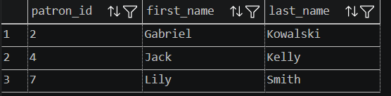
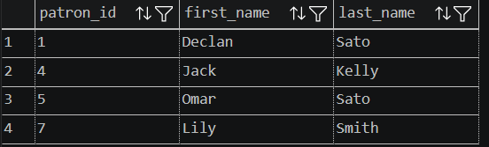
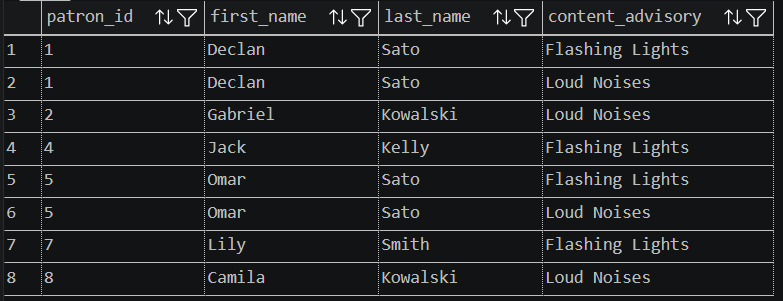
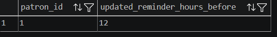
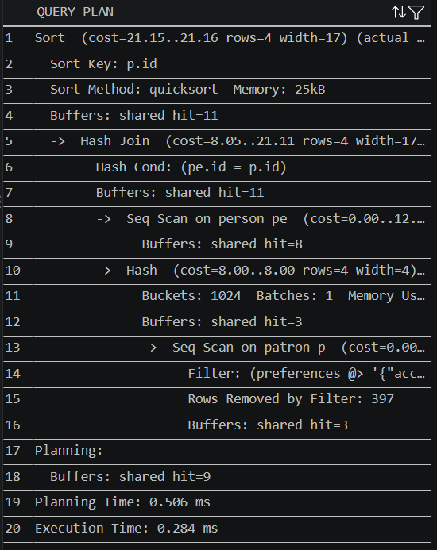

# Part B: JSONB Query Results

## Query 1: Containment Query (@>)
Find patrons that need wheelchair accessible seating.

**Result:**

## Query 2: JSON Path Query (@?)
Find patrons that have selected Flashing Lights as a content advisory.

**Result:**

## Query 3: JSONB Array to Rows and Relational JOIN
List each patron's content advisories.

**Result:**

## Query 4: Update Nested JSONB Value (jsonb_set)
Update patron ID 1's event reminder time to 12 hours.

**Result:**

## EXPLAIN Plan: Containment Query
Check whether PostgreSQL used the GIN index for the containment query.

**Result:**

PostgreSQL used a sequential scan instead of the GIN index. This likely happened because the patron table has around 400 rows, so a sequential scan is more efficient.
