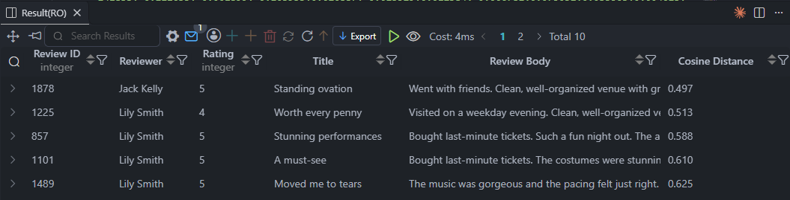
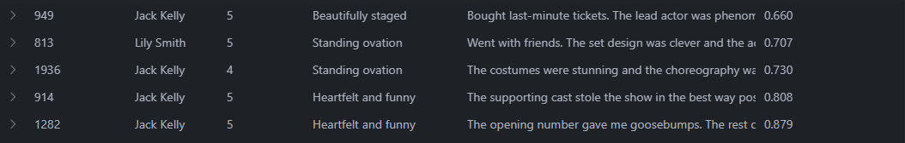

# Part D: Combined Query Results

**Request (plain English):** *"I use a wheelchair. Before I buy tickets, show me what other patrons who also need wheelchair-accessible seating said about how comfortable the venue was and how well they could see the stage. Don't include reviews written by staff."*

**Query:** [`SQL_Scripts/part_d_combined_query_filled.sql`](../SQL_Scripts/part_d_combined_query_filled.sql)

| Condition | Part | How it is applied |
|---|---|---|
| Similar to "comfortable, accessible venue with a clear view of the stage" | C: vector | `ORDER BY embedding <=> query_vector` |
| Reviewer is a Patron and not Staff | A: class hierarchy | `JOIN patron` + `NOT EXISTS (staff)` |
| Patron needs wheelchair-accessible seating | B: JSONB | `preferences @> '{"accessibility":{"wheelchair_accessible":true}}'` |

## Results

The screenshots show all 10 reviews that pass the hierarchy and JSONB filters, ranked by cosine distance. The query file returns the top 5 (`LIMIT 5`), which are on the first page.

**Page 1 (top 5, the submitted result):**

**Page 2 (ranks 6 to 10):**

| Rank | Review | Reviewer | Rating | Title | Cosine distance | Relevant |
|---|---|---|---|---|---|---|
| 1 | 1878 | Jack Kelly | 5 | Standing ovation | 0.497 | Y: "Clean, well-organized venue with great sightlines" |
| 2 | 1225 | Lily Smith | 4 | Worth every penny | 0.513 | Y: "Clean, well-organized venue with great sightlines" |
| 3 | 857 | Lily Smith | 5 | Stunning performances | 0.588 | N |
| 4 | 1101 | Lily Smith | 5 | A must-see | 0.610 | N |
| 5 | 1489 | Lily Smith | 5 | Moved me to tears | 0.625 | N |
| 6 | 949 | Jack Kelly | 5 | Beautifully staged | 0.660 | N |
| 7 | 813 | Lily Smith | 5 | Standing ovation | 0.707 | N |
| 8 | 1936 | Jack Kelly | 4 | Standing ovation | 0.730 | N |
| 9 | 914 | Jack Kelly | 5 | Heartfelt and funny | 0.808 | N |
| 10 | 1282 | Jack Kelly | 5 | Heartfelt and funny | 0.879 | N |

## What the results show

- **The filters narrow 2,150 reviews to 10.** Only patrons 4 (Jack Kelly) and 7 (Lily Smith) are wheelchair users who are not staff. Patron 2 is also a wheelchair user, but is staff, so the hierarchy condition removes their 2 reviews.
- **Vector similarity ranks the two relevant reviews first.** They are the only candidates that talk about the venue and the view. Their distances (0.497 and 0.513) are clearly lower than the rest (0.588 and above), which talk about the cast, costumes or music.
- **Precision@5 is 2/5 = 0.40.** This is limited by the data, not the ranking: only 2 of the 10 candidates are relevant, and both rank first. Only 8 of 400 patrons have preferences in the sample data, so few reviewers pass the JSONB filter.
- **The filters run before the ranking.** The query filters in a `MATERIALIZED` CTE and then ranks the 10 candidates exactly. Going through the HNSW index would apply the filters only after collecting about 40 nearest neighbours, which could return fewer than 5 rows for a filter this selective.
